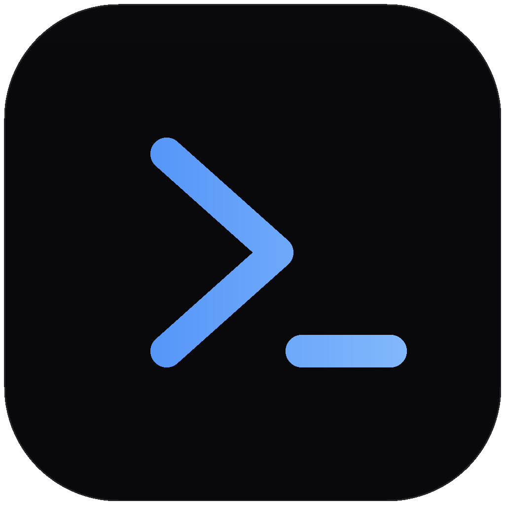

<p align="center">
  
</p>

<h1 align="center">TermZip</h1>

<p align="center">
  <b>A fast, beautiful terminal for people who build things.</b><br />
  An open-source desktop terminal written in Rust, with the command line anchored at the bottom.
</p>

<p align="center">
  <a href="https://github.com/LuisPeixoto/TermZip/actions/workflows/ci.yml"></a>
  <a href="LICENSE"></a>
  <a href="https://github.com/LuisPeixoto/TermZip/releases"></a>
  
  
  <a href="CONTRIBUTING.md"></a>
</p>

<p align="center">
  <a href="#getting-started">Getting started</a> ·
  <a href="docs/roadmap.md">Roadmap</a> ·
  <a href="docs/architecture.md">Architecture</a> ·
  <a href="docs/shell-integration.md">Shell integration</a> ·
  <a href="docs/terminal-compatibility.md">Compatibility</a> ·
  <a href="docs/compatibility-matrix.md">Test matrix</a> ·
  <a href="docs/distribution.md">Distribution</a> ·
  <a href="CONTRIBUTING.md">Contributing</a>
</p>

TermZip is a native desktop terminal for macOS, Windows, and Linux. The command composer stays fixed at the bottom of
the window while output, scrollback, and **command blocks** scroll above it — your next command is always where your
eyes already are.

## Highlights

- **Bottom-anchored composer.** Type in a fixed footer; Enter runs, Shift+Enter adds a line, and the arrow keys walk
  through your command history.
- **Real command blocks.** With an integrated shell, every command becomes a card with its command text, exit code,
  duration, working directory, and an ANSI-colored output preview — copyable and re-runnable in one click.
- **A real terminal, always.** The canvas is a full terminal emulator: vim, htop, tmux, SSH, and REPLs work as usual,
  with selection, clipboard, bracketed paste, and resize.
- **Private by design.** No accounts, no telemetry, no cloud. Terminal contents never leave your machine.
- **Rust core, native shell.** Sessions run in a real PTY via a small Rust engine; the interface is a fast Tauri app.
- **Zinc & blue.** A calm, high-contrast visual system with complete dark and light themes.

## Getting started

Install [Rust](https://rustup.rs) and [Node.js](https://nodejs.org) 20+, then:

```bash
git clone https://github.com/LuisPeixoto/TermZip.git
cd TermZip/apps/desktop
npm install
npm run tauri dev
```

Build a release bundle:

```bash
npm run tauri build
```

On Linux you also need the WebKitGTK development packages (`libwebkit2gtk-4.1-dev`, `libappindicator3-dev`,
`librsvg2-dev`).

## How the bottom composer works

TermZip injects a small integration script into zsh, bash, fish, and PowerShell that emits the
[semantic-prompt protocol](https://gitlab.freedesktop.org/per_1/terminal-wg/issues/5) (OSC 133). TermZip reads those
markers to build blocks — your prompt, aliases, and plugins are untouched. Shells without integration (cmd.exe, tcsh)
still work as a plain terminal; only block capture is unavailable.

See [docs/shell-integration.md](docs/shell-integration.md) and
[docs/terminal-compatibility.md](docs/terminal-compatibility.md) for details and current limitations.

## Project structure

| Area | Location |
|---|---|
| Desktop app (Tauri + Svelte + xterm.js) | `apps/desktop` |
| Rust shell (sessions, blocks, settings) | `apps/desktop/src-tauri` |
| Shell integration and OSC 133 parser | `crates/termzip-shell` |
| Cross-platform PTY (ConPTY on Windows) | `crates/termzip-pty` |
| Settings and shared tokens | `crates/termzip-core` |
| App icon source | `assets/` |

## Contributing

Issues and focused pull requests are welcome. Read [CONTRIBUTING.md](CONTRIBUTING.md) for branch naming, Conventional
Commits, and the checks every change must pass.

## Security

TermZip runs a shell with your user's permissions. Report vulnerabilities privately using GitHub's
[security advisory form](https://github.com/LuisPeixoto/TermZip/security/advisories/new). See
[SECURITY.md](SECURITY.md) for the current threat model.