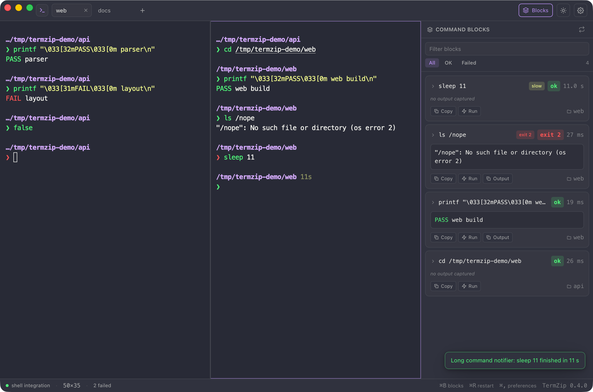
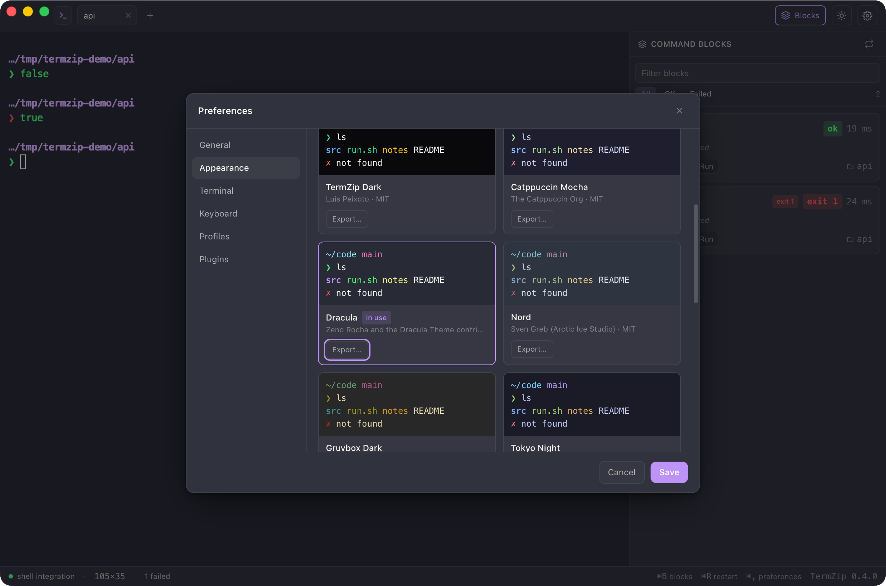
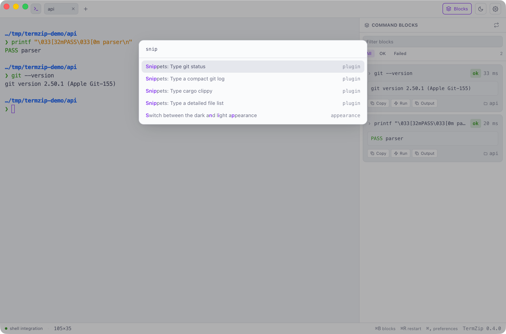
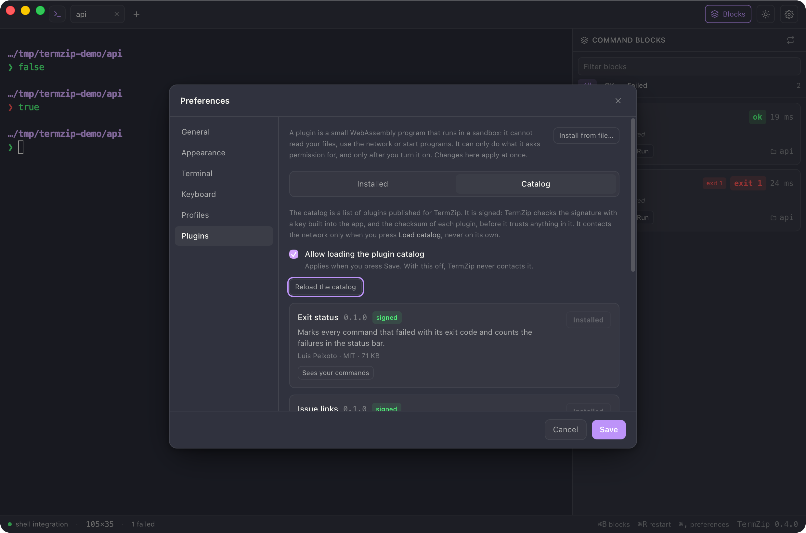

<p align="center">
  
</p>

<h1 align="center">TermZip</h1>

<p align="center">
  <b>A fast, beautiful terminal for people who build things.</b><br />
  An open-source desktop terminal written in Rust that turns every command into a block you can copy and re-run.
</p>

<p align="center">
  <a href="https://github.com/LuisPeixoto/TermZip/actions/workflows/ci.yml"></a>
  <a href="LICENSE"></a>
  <a href="https://github.com/LuisPeixoto/TermZip/releases"></a>
  
  
  <a href="CONTRIBUTING.md"></a>
</p>

<p align="center">
  <a href="#getting-started">Getting started</a> ·
  <a href="docs/roadmap.md">Roadmap</a> ·
  <a href="docs/architecture.md">Architecture</a> ·
  <a href="docs/tabs-and-panes.md">Tabs and panes</a> ·
  <a href="docs/themes.md">Themes</a> ·
  <a href="docs/keyboard.md">Keyboard</a> ·
  <a href="docs/plugins.md">Plugins</a> ·
  <a href="docs/configuration.md">Configuration</a> ·
  <a href="docs/shell-integration.md">Shell integration</a> ·
  <a href="docs/troubleshooting.md">Troubleshooting</a> ·
  <a href="docs/terminal-compatibility.md">Compatibility</a> ·
  <a href="docs/compatibility-matrix.md">Test matrix</a> ·
  <a href="docs/distribution.md">Distribution</a> ·
  <a href="CONTRIBUTING.md">Contributing</a>
</p>

TermZip is a native desktop terminal for macOS, Windows, and Linux. You type straight into a real terminal, and a
side rail turns every finished command into a **block** with its exit code, duration, and output — ready to copy or
run again. Tabs and split panes keep several shells in one window, and your layout comes back on the next launch.

## Highlights

- **Type where you read.** The terminal is the only input: your shell's line editor, history, completion, and
  keybindings work exactly as they do in any terminal.
- **Real command blocks.** With an integrated shell, every command becomes a card with its command text, exit code,
  duration, working directory, and an ANSI-colored output preview — copyable and re-runnable in one click.
- **Tabs and split panes.** Several shells in one window, split right or down, resizable, each with its own blocks.
  Your tabs, splits, and folders are restored on the next launch (structure only, never terminal output).
- **Find and filter.** ⌘F searches the scrollback with highlights and a count; the blocks rail filters by text and by
  status.
- **Links that are safe to click.** ⌘+click opens URLs, hyperlinks, and files; a click can never start a program.
- **Profiles.** A shell, folder, and environment per profile, one click away from the new-tab button.
- **A real terminal, always.** The canvas is a full terminal emulator: vim, htop, tmux, SSH, and REPLs work as usual,
  with selection, clipboard, bracketed paste, and resize.
- **Private by design.** No accounts, no telemetry, no cloud. Terminal contents never leave your machine.
- **Rust core, native shell.** Sessions run in a real PTY via a small Rust engine; the interface is a fast Tauri app.
- **Themes you can bring.** Twelve audited themes (Catppuccin, Dracula, Nord, Gruvbox, Tokyo Night, One Dark, Rosé
  Pine and TermZip's own) recolor the whole window, and iTerm2, Windows Terminal, Ghostty, Kitty and Alacritty themes
  import as they are.
- **Yours to shape.** Cursor, line height, letter spacing, a translucent window with native blur, and a look of its
  own for each profile.
- **Every shortcut is yours.** Rebind any of them in Preferences, with a warning before you take a key your shell
  uses, and find anything with the command palette (⇧⌘P).
- **Plugins in a sandbox.** Small WebAssembly files add palette commands, block labels, status items and links. A plugin
  cannot read your files, use the network or start a program; it asks for each thing it may see or do, and you approve
  it first. A signed catalog is one click away, and you can write your own in Rust.
- **Zinc & blue by default.** A calm, high-contrast visual system with complete dark and light themes.

## Screenshots

<p align="center">
  
  <br />
  <sub>Dracula, one of the twelve built-in themes, with three plugins running: a red <b>exit 2</b> and an amber <b>slow</b> label on the blocks, a message when <code>sleep 11</code> ends, and <b>2 failed</b> in the status bar.</sub>
</p>

<p align="center">
  
  <br />
  <sub>Preferences → Appearance. Every theme is previewed in its own colors, and the window follows your choice before you save.</sub>
</p>

<p align="center">
  
  <br />
  <sub>Catppuccin Latte with the command palette (⇧⌘P): every action, tab, profile, and theme, and the commands of your plugins, marked as such.</sub>
</p>

<p align="center">
  
  <br />
  <sub>Preferences → Plugins → Catalog. The list is checked against a signature before it is trusted, and every plugin shows what it will ask for.</sub>
</p>

## Getting started

Install [Rust](https://rustup.rs) and [Node.js](https://nodejs.org) 20+, then:

```bash
git clone https://github.com/LuisPeixoto/TermZip.git
cd TermZip/apps/desktop
npm install
npm run tauri dev
```

Build a release bundle:

```bash
npm run tauri build
```

On Linux you also need the WebKitGTK development packages (`libwebkit2gtk-4.1-dev`, `libappindicator3-dev`,
`librsvg2-dev`).

## How command blocks work

TermZip injects a small integration script into zsh, bash, fish, and PowerShell that emits the
[semantic-prompt protocol](https://gitlab.freedesktop.org/per_1/terminal-wg/issues/5) (OSC 133). TermZip reads those
markers to build blocks — your prompt, aliases, and plugins are untouched. Shells without integration (cmd.exe, tcsh)
still work as a plain terminal; only block capture is unavailable.

See [docs/shell-integration.md](docs/shell-integration.md) and
[docs/terminal-compatibility.md](docs/terminal-compatibility.md) for details and current limitations.

## Keyboard shortcuts

| Action | macOS | Windows and Linux |
|---|---|---|
| New tab | ⌘T | Ctrl+Shift+T |
| Close the active pane (the last one closes the tab) | ⌘W | Ctrl+Shift+W |
| Split right / split down | ⌘D / ⇧⌘D | Ctrl+Shift+D / Ctrl+Shift+E |
| Move between panes | ⌥⌘ + arrow | Ctrl+Alt + arrow |
| Next / previous tab | ⇧⌘] / ⇧⌘[ | Ctrl+Tab / Ctrl+Shift+Tab |
| Go to tab 1 to 9 | ⌘1 … ⌘9 | Ctrl+Shift+1 … 9 |
| Command palette | ⇧⌘P | Ctrl+Shift+P |
| Find in the terminal | ⌘F | Ctrl+Shift+F |
| Toggle the blocks rail | ⌘B | Ctrl+Shift+B |
| Restart the shell | ⌘R | Ctrl+Shift+R |
| Preferences | ⌘, | Ctrl+, |
| Copy / paste / select all in the terminal | ⌘C / ⌘V / ⌘A | Ctrl+Shift+C / V / A |

On Windows and Linux the application shortcuts use Ctrl+Shift, so plain Ctrl+R (reverse search), Ctrl+B and the other
Ctrl keys always reach your shell. Ctrl+C still interrupts the running command. Every shortcut can be changed in
**Preferences → Keyboard** (see [keyboard](docs/keyboard.md)).

## Documentation

| Guide | What it covers |
|---|---|
| [Configuration](docs/configuration.md) | Where settings live, every option, `TERMZIP_HOME`, what happens to a broken file. |
| [Tabs and panes](docs/tabs-and-panes.md) | Tabs, splits, focus, the layout tree, and the limits. |
| [Search and filter](docs/search-and-filter.md) | Find in the terminal and filter the blocks. |
| [Links](docs/links.md) | What is recognized, what opens, and why a click never starts a program. |
| [Themes](docs/themes.md) | The gallery and its credits, importing and exporting, the theme file, and how the interface colors are derived. |
| [Appearance](docs/appearance.md) | Cursor, spacing, window opacity and blur on each system, and per-profile looks. |
| [Keyboard and command palette](docs/keyboard.md) | Every default shortcut, the editor, `[keybindings]`, and what the palette lists. |
| [Plugins](docs/plugins.md) | What a plugin can do, installing from a file or the signed catalog, permissions, and the limits. |
| [Plugin API](docs/plugin-api.md) | For authors: the manifest, the ABI, actions, limits, the versioning policy, and the Rust SDK. |
| [Profiles and restore](docs/profiles-and-restore.md) | Shell, folder, and environment per profile; what is saved between launches. |
| [Performance and limits](docs/performance.md) | Flow control for floods of output, block events, and every bound. |
| [Shell integration](docs/shell-integration.md) | The OSC 133 markers, supported shells, and the limits of block capture. |
| [Terminal compatibility](docs/terminal-compatibility.md) | What is implemented, verified, and still missing. |
| [Compatibility matrix](docs/compatibility-matrix.md) | What has been exercised on each operating system. |
| [Architecture](docs/architecture.md) | Crates, the session stream, and the design rules. |
| [Troubleshooting](docs/troubleshooting.md) | Symptom, cause, and fix for the problems seen so far. |
| [Distribution](docs/distribution.md) | Building bundles and the release workflow. |
| [Roadmap](docs/roadmap.md) | Finished phases and what comes next. |

## Project structure

| Area | Location |
|---|---|
| Desktop app (Tauri + Svelte + xterm.js) | `apps/desktop` |
| Rust shell (sessions, blocks, settings) | `apps/desktop/src-tauri` |
| Shell integration and OSC 133 parser | `crates/termzip-shell` |
| Cross-platform PTY (ConPTY on Windows) | `crates/termzip-pty` |
| Settings and shared tokens | `crates/termzip-core` |
| Plugin API types, the host (sandbox, store, catalog) and the SDK | `crates/termzip-plugin-api`, `crates/termzip-plugins`, `crates/termzip-plugin-sdk` |
| Example plugins | `examples/plugins` |
| App icon source | `assets/` |

## Contributing

Issues and focused pull requests are welcome. Read [CONTRIBUTING.md](CONTRIBUTING.md) for branch naming, Conventional
Commits, and the checks every change must pass.

## Security

TermZip runs a shell with your user's permissions. Report vulnerabilities privately using GitHub's
[security advisory form](https://github.com/LuisPeixoto/TermZip/security/advisories/new). See
[SECURITY.md](SECURITY.md) for the current threat model.