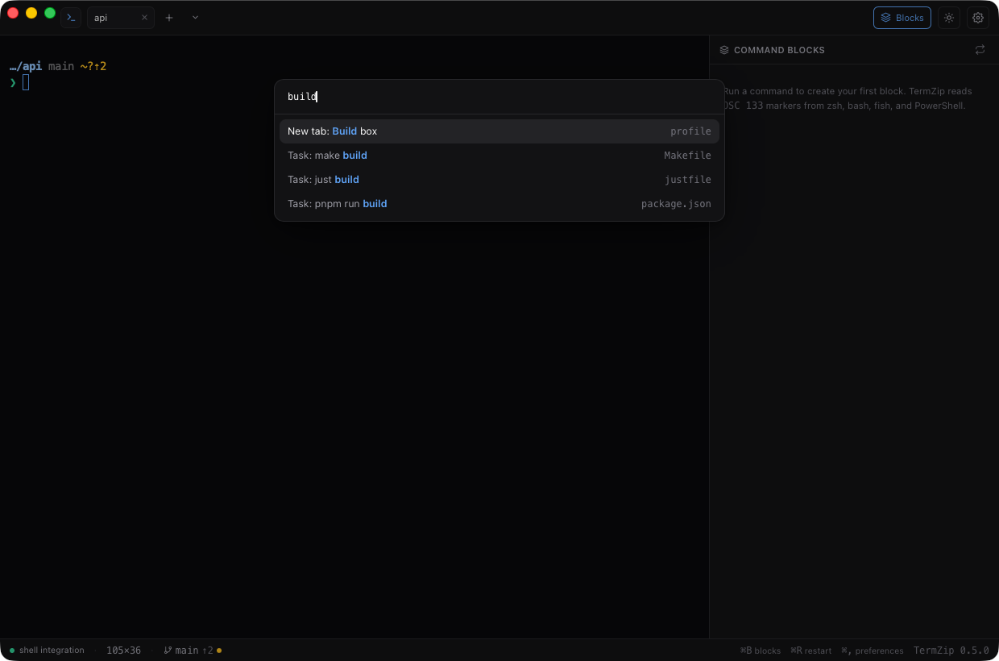

# Project tasks and folder profiles

## Tasks in the palette

Open the [command palette](keyboard.md#the-command-palette) (⇧⌘P) in a terminal that is inside a project and the
project's own commands are there, each marked with the file it comes from:

```text
Task: pnpm run build          package.json
Task: cargo test              Cargo
Task: make lint               Makefile
Task: just release            justfile
Task: deno task dev           deno.json
```

<p align="center">
  
</p>

Choosing one **types** the command at the prompt; it never runs it. Read it, change it (add `-- --release`, say) and
press Enter.

| Source | What is offered | How it is typed |
|---|---|---|
| `package.json` | Each entry of `scripts`. | `npm run name`, `pnpm run name`, `yarn run name` or `bun run name`: the `packageManager` field decides, else the lock file (`pnpm-lock.yaml`, `yarn.lock`, `bun.lockb`), else npm. |
| Cargo | `build`, `test`, `run`, `check`, `clippy`, `fmt`, and the `[alias]` entries of `.cargo/config.toml`. | `cargo name` |
| Makefile | The targets: names at the start of a line. Special targets (`.PHONY`), pattern rules (`%.o`), file paths and variables are left out. | `make name` |
| justfile | The recipes. Private ones (`_name`, or after `[private]`), settings, variables and aliases are left out. | `just name` |
| `deno.json` | Each entry of `tasks`. | `deno task name` |

### Which file counts

It follows how the tool itself looks for its file:

- `npm`, `pnpm`, `yarn`, `bun`, `cargo`, `just` and `deno` walk up the folders, so the **nearest** file is used, up to the
  root of the repository (the folder with `.git`) and at most 8 folders up. In `apps/web` of a monorepo you get the
  scripts of `apps/web/package.json`, not the root's, which is what `npm run` would run there.
- `make` reads only the Makefile of the **current folder**, so a Makefile in a parent folder is not offered.

The list is read when the palette opens, so it is always the files as they are now.

### Limits and safety

The files of a project you just cloned are not trusted:

- A file must be a regular file of at most **256 KiB** (a named pipe is never opened); at most **200 tasks** are listed.
- A task name must be plain: letters, digits and `. _ : / @ + -`, up to 64 characters, never starting with `-`. A script
  called `build; curl example.com | sh` is simply not offered, so a name can never add a second command to the line.
- Nothing is run to find tasks: the files are only read.
- A `deno.jsonc` (with comments) is not read.

## Profiles tied to folders

A [profile](profiles-and-restore.md) can name folders. A new terminal that starts in one of them, or below, uses that
profile (its shell, environment and look), when you did not choose another.

```toml
[[profiles]]
name = "API"
folders = ["~/work/api"]
theme = "nord"
[profiles.env]
AWS_PROFILE = "work"
```

In **Preferences → Profiles**, the profile form has a *folders* field, one per line.

- The folder a terminal starts in is the one the pane was in (a new tab or split opened from it, a layout coming back),
  or else the default working folder. If several profiles match, the one with the **deepest** folder wins, and the first
  when two tie.
- A profile you ask for (the caret next to **+**, the palette, **Built-in**) is never replaced.
- Matching is by whole folders (`/srv/app` does not match `/srv/application`), the folder must exist, and symbolic links
  are not resolved.
- The pane keeps the profile from then on, so a split or a restart uses the same one and the layout is saved with it.
- Limits: 16 folders per profile, 1 KiB each.
